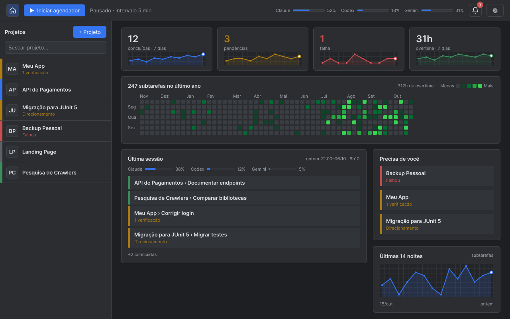
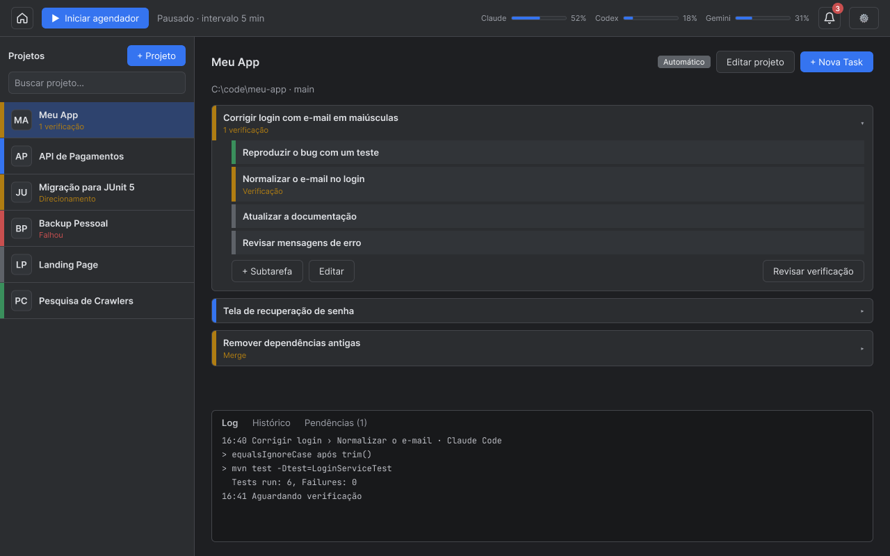
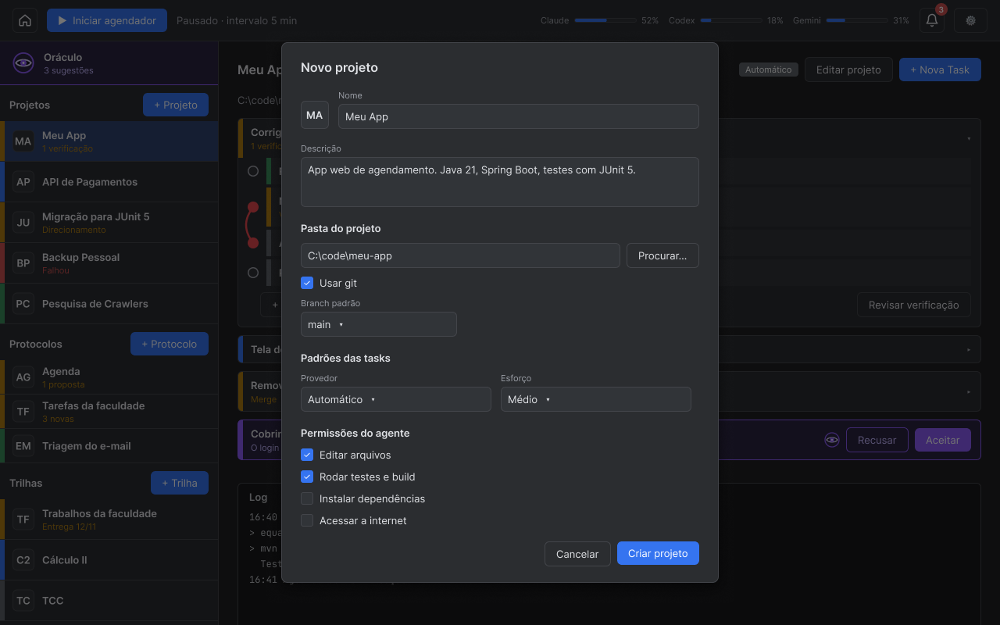
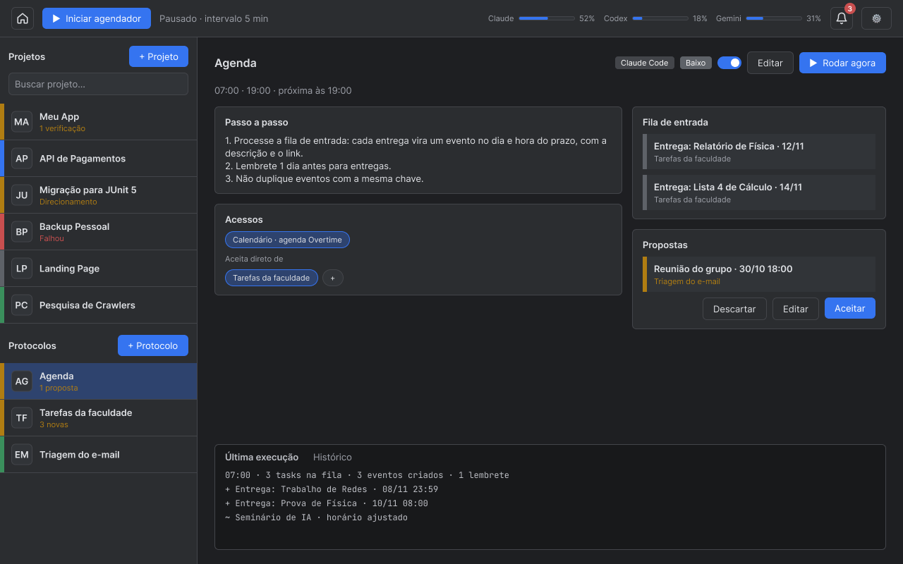
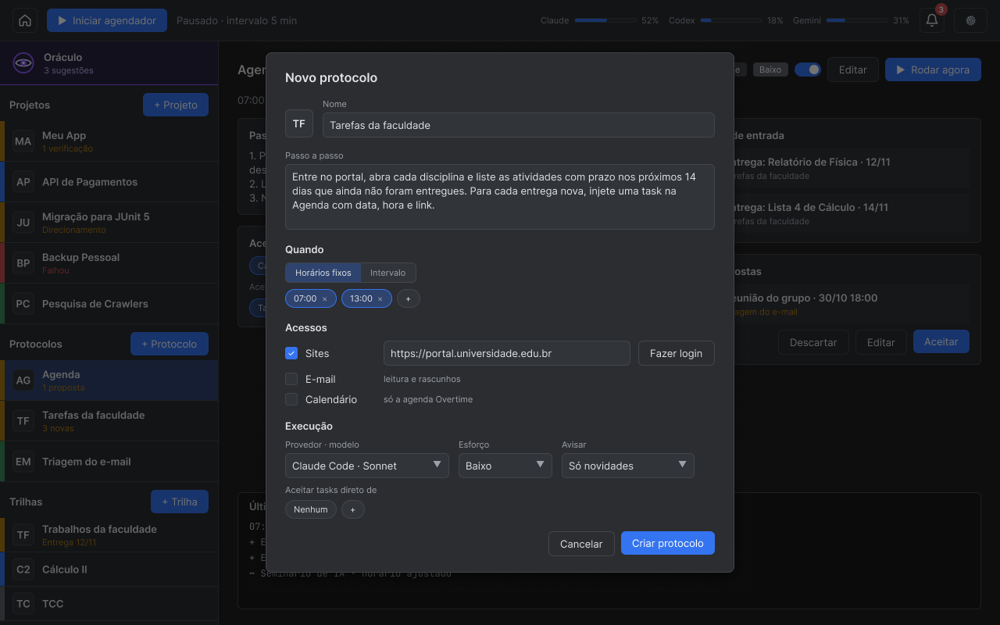
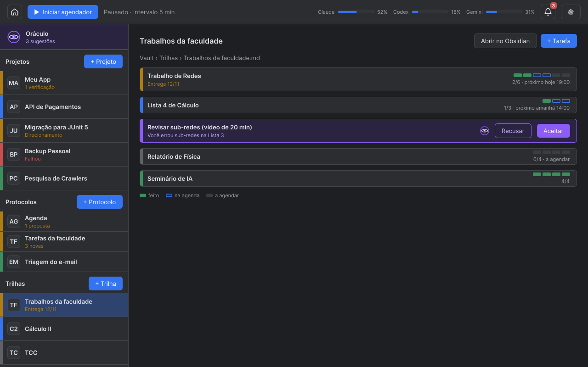
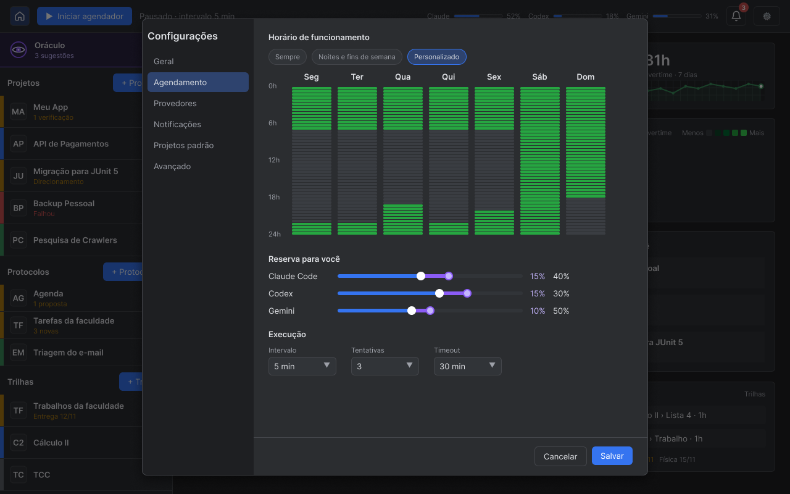
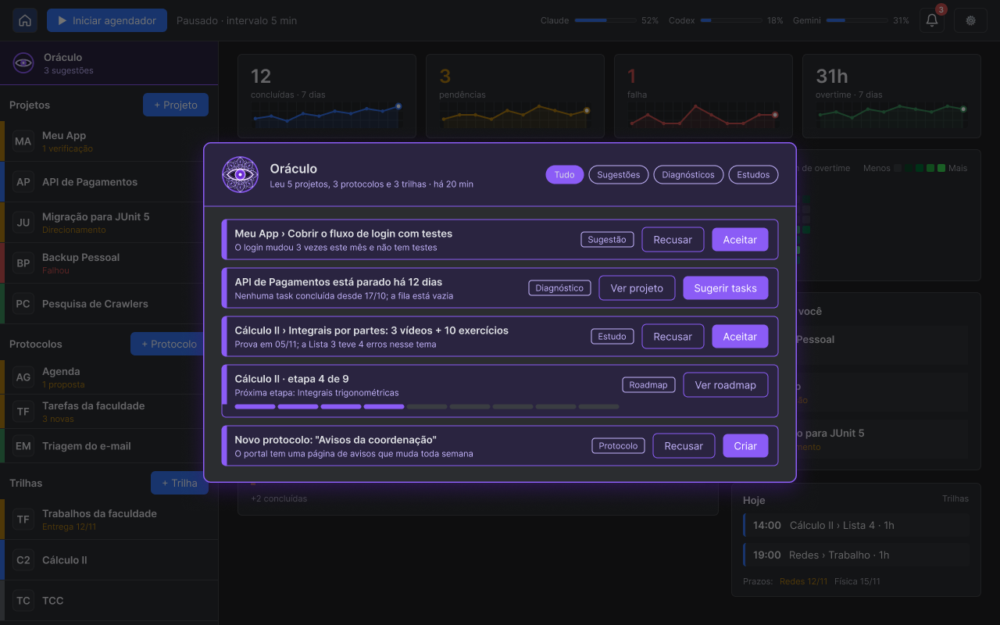

# Overtime Dispatcher

Aplicação desktop que mantém uma **fila de tarefas** para agentes de IA — Claude Code, Codex e Gemini — e as executa automaticamente quando o agente está ocioso, aproveitando os créditos das suas assinaturas sem gastar a parte reservada para o seu uso manual.

Serve para qualquer tipo de projeto: desenvolvimento de software, pesquisa, escrita, organização de documentos, automações do dia a dia.

> Status: **protótipo das telas** (branch `dev`), com dados de exemplo.

## Como rodar

Requer JDK 25 e Maven. Abra a pasta no IntelliJ IDEA (projeto Maven) e execute `OvertimeDispatcher`. Para evitar o aviso de acesso nativo do FlatLaf, adicione `--enable-native-access=ALL-UNNAMED` às opções da VM na configuração de execução.

Para compilar pelo terminal:

```bash
mvn package
```

## Como funciona

Você organiza o trabalho em **Projetos** e, dentro deles, **Tasks**, cada uma quebrada em **Subtarefas** pequenas. Nos horários que você liberar, a app entrega a próxima subtarefa a um agente livre e registra o resultado.

Além dos projetos, você cria **Protocolos**: rotinas que o agente segue de tempos em tempos, como ver as tarefas no portal da faculdade, ler o e-mail e montar um resumo, ou organizar a agenda dele com base no que encontrou.

Para o que é trabalho seu, existem as **Trilhas**: tarefas como estudos e trabalhos da faculdade, com o tempo dividido em blocos que vão para a agenda e guardadas no seu vault do Obsidian.

Acima de tudo isso está o **Oráculo**, que observa projetos, protocolos e trilhas e sugere o que fazer a seguir.

Quando algo exige uma decisão sua, a app avisa (na tela, no desktop e pelo WhatsApp) e espera. Com a janela fechada, ela continua trabalhando na bandeja do Windows.

## Telas

Protótipos no Figma ([OvertimeDispatcher](https://www.figma.com/design/0BqwZD0E88qRrWcxHGRb49/OvertimeDispatcher)).

### Home

O ponto de partida do dia: quanto os agentes produziram, o que aconteceu na última sessão de overtime, o que está esperando uma decisão sua e os blocos de estudo e trabalho marcados para hoje.



### Projeto

Onde você organiza o trabalho dos agentes: quebra cada Task em subtarefas, define o que depende do quê, acompanha o que o agente está fazendo e revisa o que ficou pronto.



Ao criar um projeto, você escolhe a pasta do computador onde ele vive, se ela usa git, os padrões das tasks e o que o agente pode fazer.



### Protocolo

Onde você define uma rotina para o agente seguir: o passo a passo, quando roda, o que ele pode acessar e de quem aceita tarefas. Mostra o que chegou de outros protocolos, as propostas esperando você e o que foi feito na última execução.



Ao criar um protocolo, você escreve o passo a passo, escolhe os horários, os acessos (sites, e-mail, calendário) e quanto esforço o agente deve usar.



### Trilha

Onde ficam as suas tarefas: estudos, trabalhos e projetos pessoais, cada um com o tempo dividido em blocos. Mostra o que já foi feito, o que está na agenda e o próximo bloco. Tudo fica num arquivo do seu vault do Obsidian.



### Configurações

Define quando os agentes podem trabalhar sozinhos em cada dia da semana e como os créditos de cada assinatura se dividem entre a automação, o Oráculo e você.



## Oráculo

O Oráculo é quem pensa no que vem depois. Ele lê os projetos, os protocolos e as trilhas e entende em que ponto cada um está. A partir disso:

- **sugere tasks** quando um projeto contínuo fica sem trabalho, sempre com uma frase dizendo **por quê**;
- **faz diagnósticos**, como um projeto parado, testes falhando ou tasks rejeitadas pelo mesmo motivo;
- **monta e acompanha roadmaps**, principalmente de estudos, marcando o progresso a cada etapa concluída;
- **sugere estudos** (vídeos, leituras, exercícios) a partir das matérias e dos trabalhos da faculdade;
- **propõe novos protocolos** quando percebe algo que vale acompanhar sempre.

Ele não executa nada sozinho: tudo o que sugere chega para você **aceitar ou recusar**, e a recusa ensina o que não sugerir de novo. Tudo o que vem do Oráculo aparece em **roxo**, e ele tem uma fatia própria dos créditos, definida nas configurações.



## Princípios

- **Você tem prioridade** — a automação nunca consome os créditos reservados para o seu uso manual.
- **Você decide o que entra** — se o projeto usa git, o agente trabalha numa branch separada e nada chega à main sem a sua verificação.
- **Não fica parado** — quando precisa de você, o agente segue para outra tarefa enquanto espera.
- **Trabalha em segundo plano** — roda com a janela fechada e avisa quando precisa de você.
- **Vários agentes, uma fila** — Claude Code, Codex e Gemini, cada um com os créditos da sua assinatura.

## Documentação

| Documento | Conteúdo |
|---|---|
| [Decisões](docs/decisoes.md) | Registro das decisões técnicas |
| [Ideias em aberto](docs/ideias-em-aberto.md) | Propostas ainda não confirmadas |
| [Arquitetura](docs/arquitetura.md) | MVC, módulos, tecnologia e distribuição |
| [Domínio](docs/dominio.md) | Projetos, Tasks, subtarefas, Protocolos, Trilhas e Oráculo |
| [Diagramas](docs/diagramas.md) | Diagrama de classes e diagramas de casos de uso (UML) |
| [Interfaces](docs/interfaces.md) | Figma e diretrizes visuais |

### Módulos

| Módulo | Documento |
|---|---|
| Agentes (Claude Code, Codex, Gemini) | [agente.md](docs/modulos/agente.md) |
| Agendador | [agendador.md](docs/modulos/agendador.md) |
| Consumo (horário e reserva) | [consumo.md](docs/modulos/consumo.md) |
| Comunicação (app, desktop, WhatsApp) | [comunicacao.md](docs/modulos/comunicacao.md) |
| Persistência | [persistencia.md](docs/modulos/persistencia.md) |
| RPC e MCP | [rpc.md](docs/modulos/rpc.md) |
| Protocolos | [protocolos.md](docs/modulos/protocolos.md) |
| Trilhas | [trilhas.md](docs/modulos/trilhas.md) |
| Oráculo (em definição) | [oraculo.md](docs/modulos/oraculo.md) |
| Interface | [ui.md](docs/modulos/ui.md) |

## Glossário

| Termo | Significado |
|---|---|
| **Projeto** | Agrupa Tasks com o mesmo contexto e aponta para uma pasta do seu computador, com ou sem git. |
| **Task** | Trabalho para um agente, dividido em subtarefas pequenas. |
| **Protocolo** | Rotina que o agente segue de tempos em tempos (ex.: portal da faculdade, e-mail, agenda). |
| **Trilha** | Conjunto de tarefas para você, com o tempo planejado em blocos; fica no seu vault do Obsidian. |
| **Oráculo** | Observa tudo e sugere o que fazer: tasks, diagnósticos, roadmaps e estudos. |
| **Reserva** | Parte dos créditos de cada assinatura que a automação não usa. |
