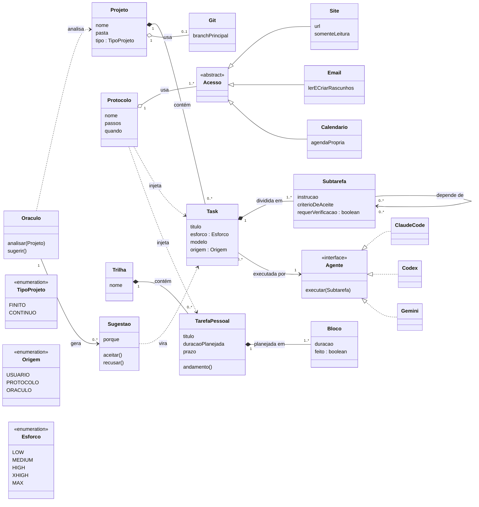
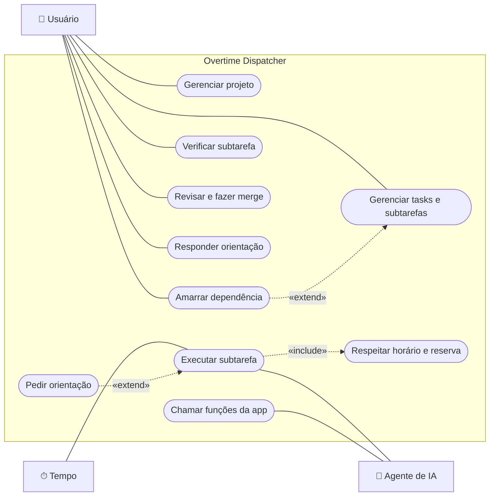
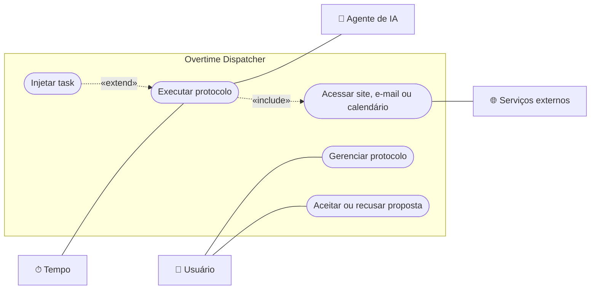
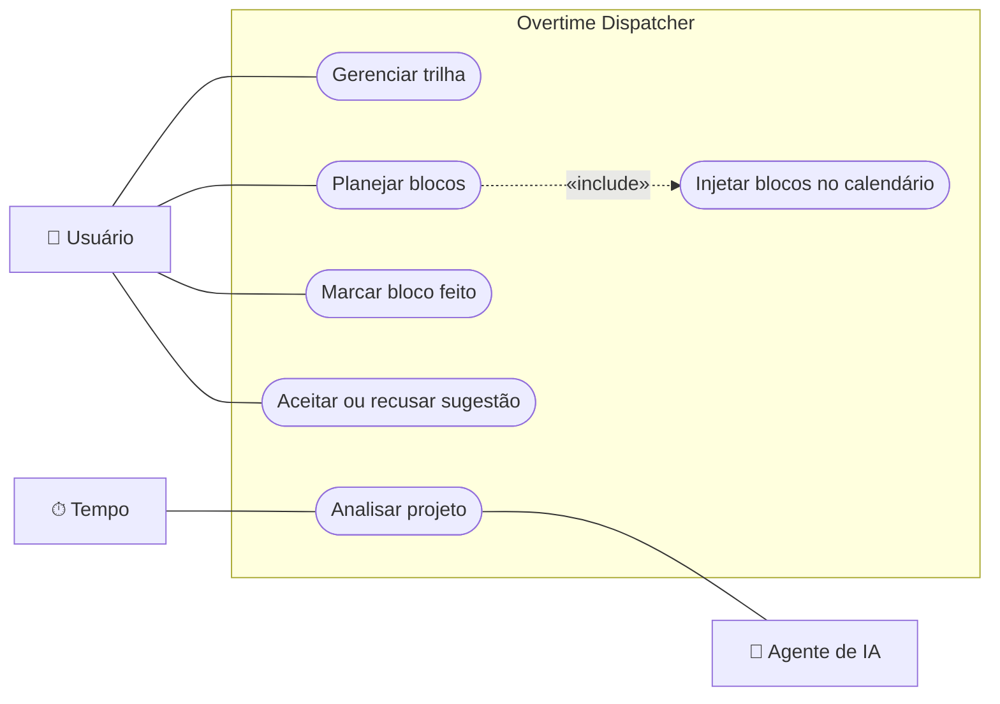
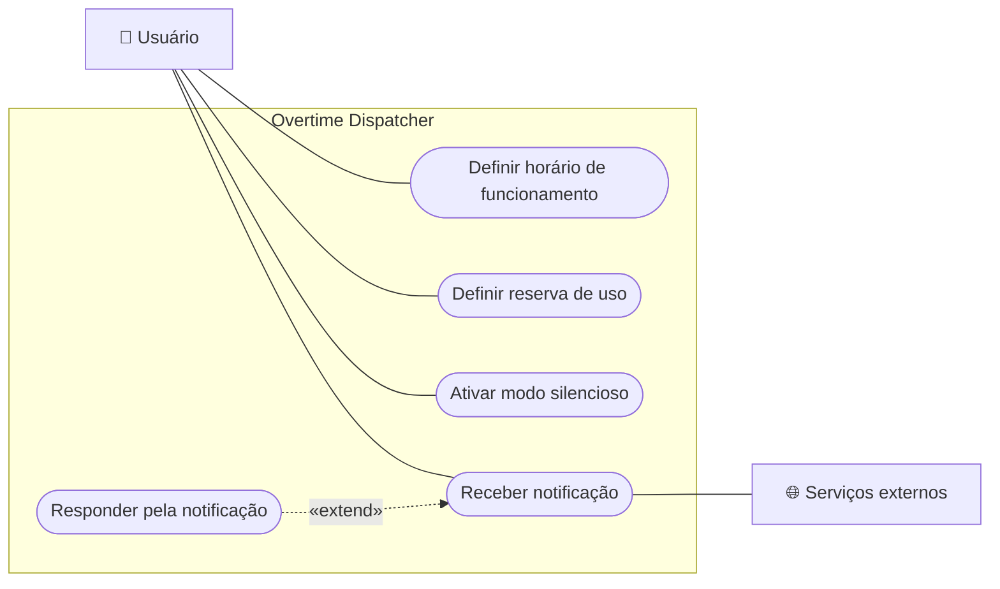

# Diagramas

Diagramas UML em [Mermaid](https://mermaid.js.org/). O GitHub os exibe diretamente.

## Diagrama de classes (Model)

Classes do domínio e a interface comum dos agentes. Atributos e operações aparecem só quando já foram definidos.

## Diagrama de casos de uso

O Mermaid não tem um tipo nativo de casos de uso. A notação UML é representada com um fluxograma:
- **atores** fora da fronteira do sistema;
- **casos de uso** em formato oval;
- **associações** em linha contínua;
- `«include»` e `«extend»` em seta tracejada.

Um diagrama por área do sistema. O ator principal fica à esquerda e os atores secundários, à direita.

| Ator | Papel |
|---|---|
| **Usuário** | Quem usa a aplicação |
| **Tempo** | Dispara o que roda sozinho (horário de funcionamento, horários dos protocolos) |
| **Agente de IA** | Claude Code, Codex ou Gemini |
| **Serviços externos** | Portal da faculdade, e-mail, calendário, WhatsApp |

### Projetos e execução

### Protocolos

### Trilhas e Oráculo

### Configuração e avisos

